<h1 align="center">Parcel singulation on an Active Motor Surface with deep reinforcement learning (PPO)</h1>

<p align="center">
  <b>Course 062119 – Machine Learning for Mechanical Systems · Politecnico di Milano · A.Y. 2025/26</b> Department of Mechanical Engineering
</p>

<p align="center">
  
  
  
  
  
  <br>
  
  
</p>

<p align="center">
  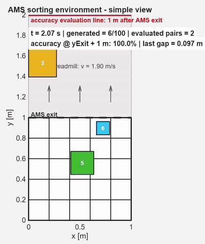
</p>

---

## TL;DR

A PPO agent learns to control a **5 × 5 grid of motorized conveyor tiles** (an *Active Motor Surface*, AMS) so that randomly sized parcels arriving in bulk leave the surface as a **single-file stream with a safe longitudinal gap** between consecutive parcels.

Our main contributions on top of the provided baseline:

1. **A fixed-size, normalized observation space** ($\mathbb{R}^{100}$) that can represent any number of parcels on the surface.
2. **A dense, multi-objective reward function** (progress − collision + exit) replacing the sparse, saturating baseline reward.
3. **PPO hyperparameter tuning** for long-horizon credit assignment.
4. **An evaluation pipeline** (Monte Carlo batch simulations and statistical post-processing of exit gaps).

| Scenario | Packages / episode | Generation interval | Runs | Mean exit gap | Mean success rate |
|---|---:|---:|---:|---:|---:|
| Nominal | 10 | 0.75 s | 100 | **0.280 m** | **99.7 %** |
| Long stream | 500 | 0.75 s | 20 | **0.278 m** | **99.5 %** (min 98.6 %) |
| Stress test (not trained for it) | 10 | 0.50 s | 100 | 0.115 m | 69.9 % |

The target minimum gap is **0.05 m**, so in nominal conditions the policy keeps on average about **5–6×** the required clearance.

---

## Table of contents

- [1. Problem](#1-problem)
- [2. Environment](#2-environment)
- [3. Method](#3-method)
  - [3.1 Observation space](#31-observation-space)
  - [3.2 Action space](#32-action-space)
  - [3.3 Baseline reward and its limitations](#33-baseline-reward-and-its-limitations)
  - [3.4 Proposed reward function](#34-proposed-reward-function)
  - [3.5 PPO agent and hyperparameters](#35-ppo-agent-and-hyperparameters)
- [4. Training](#4-training)
- [5. Evaluation](#5-evaluation)
  - [5.1 Simulation 1: 10 parcels, 0.75 s](#51-simulation-1-10-parcels-generation-interval-075-s)
  - [5.2 Simulation 2: 500 parcels, 0.75 s](#52-simulation-2-500-parcels-generation-interval-075-s)
  - [5.3 Simulation 3: 10 parcels, 0.50 s (stress test)](#53-simulation-3-10-parcels-generation-interval-050-s-stress-test)
- [6. Discussion and future work](#6-discussion-and-future-work)
- [Authors](#authors) · [References](#references)

---

## 1. Problem

In automated warehouses and fulfilment hubs, parcels often arrive **in bulk**, coming from unstacking areas or unstructured conveyor feeds. Before they reach barcode scanners, weigh-in-motion scales and high-speed cross-belt sorters, they must be **singulated**: turned into a single-file stream with consistent gaps between parcels. Without that, downstream equipment jams or reads two parcels as one.

Classic singulators use fixed-speed belt matrices or rule-based heuristics. These struggle with friction dynamics, mixed parcel sizes and irregular contact between parcels. This project uses a **data-driven approach**: a continuous-control policy trained with **Proximal Policy Optimization (PPO)** that sets the speed and direction of every tile of the surface in real time.

## 2. Environment

<p align="center">
  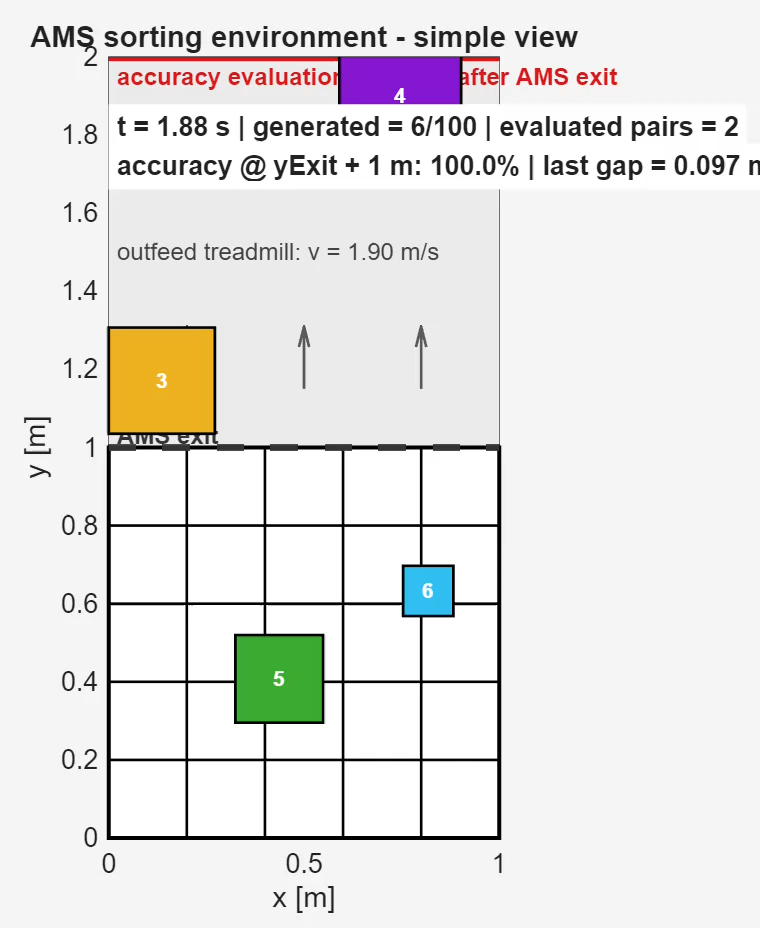
  &nbsp;&nbsp;
  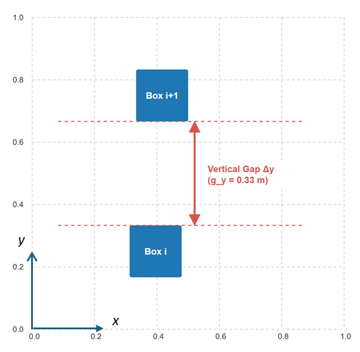
</p>
<p align="center"><sub><b>Left:</b> simulation view: the 5×5 AMS (0 ≤ y ≤ 1 m), the AMS exit, the outfeed treadmill and the accuracy evaluation line 1 m after the AMS exit. <b>Right:</b> definition of the longitudinal (vertical) gap between two consecutive parcels.</sub></p>

| Property | Value |
|---|---|
| Surface | 5 × 5 grid of independently actuated tiles, total 1.0 m × 1.0 m |
| Tile size | $d_{AMS} = 0.2$ m |
| Actuation per tile | conveying speed $v \in [0.5,\ 2.2]$ m/s and orientation $\theta \in [-\pi/4,\ \pi/4]$ relative to the main conveying axis $y$ |
| Action space | continuous, $25 \times 2 = 50$ dimensions |
| Parcel generation | 2 randomly sized parcels every $t_{gen} = 0.75$ s |
| Simulation step | $\Delta t = 0.01$ s |
| Downstream | outfeed treadmill; gaps are measured at an evaluation line 1 m after the AMS exit |

The MATLAB skeleton (parcel kinematics, generation and plotting) was provided by the course and is based on Roveda *et al.* [1]. The RL environment wrapper, observation, reward, training and evaluation code were designed and implemented by our team.

## 3. Method

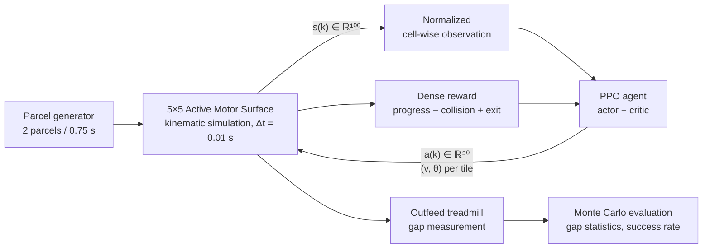

### 3.1 Observation space

The main design difficulty is that **the number of parcels on the surface changes over time**, while a neural-network policy needs an input of fixed size. We solve this by observing the **grid cells**, not the parcels: the state always has 25 cells × 4 features = 100 entries, whatever the number of parcels.

At time step $k$ (with $t = k\,\Delta t$), the observation is the concatenation of the 25 local cell vectors:

```math
s(k) = \begin{bmatrix} c_1(k) \\ c_2(k) \\ \vdots \\ c_{25}(k) \end{bmatrix} \in \mathbb{R}^{100},
\qquad
c_m(k) = \begin{bmatrix} \hat{x}_m(k) \\ \hat{y}_m(k) \\ \hat{d}_m(k) \\ o_m(k) \end{bmatrix} \in \mathbb{R}^{4}
```

The occupancy flag tells whether one or more active parcels lie inside cell $m$ ($P_m(k)$ is the set of parcels on cell $m$):

```math
o_m(k) =
\begin{cases}
1, & P_m(k) \neq \emptyset \\
0, & P_m(k) = \emptyset
\end{cases}
```

If the cell is empty, $c_m(k) = [0,\,0,\,0,\,0]^\top$. If it is occupied, the parcel features are made non-dimensional with the surface length $L_{max} = 5\,d_{AMS} = 1.0$ m and the tile size:

```math
\hat{x}_m(k) = \frac{x_i(k)}{L_{max}}, \qquad
\hat{y}_m(k) = \frac{y_i(k)}{L_{max}}, \qquad
\hat{d}_m(k) = \frac{d_i}{2\,d_{AMS}}
```

where $x_i$, $y_i$ are the transverse and longitudinal positions of parcel $i$ and $d_i$ is its characteristic size.

**Why this design:**
- **Fixed dimension:** no dimension mismatch for episodes of any length or parcel count.
- **Spatial localization:** the policy sees directly *which tile* has to act on *which parcel*.
- **Numerical stability:** all features lie in comparable ranges ($\approx [0, 1]$), which helps the actor and critic networks train well.

### 3.2 Action space

For each tile $m = 1,\dots,25$ the agent outputs a continuous pair $(v_m, \theta_m)$, giving $a(k) \in \mathbb{R}^{50}$:

```math
v_m \in [0.5,\ 2.2]\ \text{m/s}, \qquad \theta_m \in \left[-\tfrac{\pi}{4},\ \tfrac{\pi}{4}\right]
```

By speeding up some tiles and slowing down others, and by steering parcels sideways, the agent can open gaps between parcels that arrive close together.

### 3.3 Baseline reward and its limitations

The baseline reward from [1] is computed only downstream, once parcels have left the AMS. For the $K$ parcels ordered along $y$:

1. **Signed gap** between consecutive parcels:
```math
d_k = y_{min}(p_{k+1}) - y_{max}(p_k)
```
2. **Arctangent local score:**
```math
ls_k = \min\big(10 \cdot K \cdot \arctan(d_k) + K,\ 6\big)
```
3. **Worst-case pair:**
```math
r_t = \min_{1 \le k \le K-1} ls_k
```
4. **Sparse clearance bonus:**
```math
r_t \leftarrow r_t + 20 \quad \text{if } d_k > 0\ \ \forall k \ \text{ and } K \ge 3
```

This works for low-density flows but has three bottlenecks for **dense, continuous** parcel streams:

| Limitation | Effect on learning |
|---|---|
| **Sparse in space:** feedback only after parcels pass $y = 1.0$ m | No signal while parcels are on the grid, which is where the agent actually acts |
| **Saturating** $\arctan(d_k)$ | Gradients vanish for large separations, which slows early policy-gradient updates |
| **$\min(\cdot)$ over pairs** | Only the single worst pair counts; other simultaneous collisions are masked, so there is no multi-contact credit assignment |

### 3.4 Proposed reward function

We redesigned the reward as a **dense, linearly responsive, multi-objective** signal, computed at every step $\Delta t = 0.01$ s:

```math
\boxed{R(t) = R_{progress}(t) - R_{collision}(t) + R_{exit}(t)}
```

The three terms balance **throughput** (moving parcels forward), **safety** (keeping parcels apart) and **task completion** (getting parcels off the surface).

#### Progress reward: dense forward motion

```math
R_{progress}(t) = \sum_{i=1}^{N_{active}(t)} \max\big(0,\ w_p\,\Delta y_i(t)\big)
= \sum_{i=1}^{N_{active}(t)} \max\big(0,\ 120\,(y_i(t) - y_i(t-\Delta t))\big)
```

- $N_{active}(t)$: number of parcels currently on the system; $w_p = 120$.
- Only **positive** longitudinal displacement is rewarded, so the agent gains nothing from stalling, pushing parcels backwards or spinning them around. There is no stagnation penalty: slowing a parcel down on purpose to open a gap is never punished directly.
- The term is active only for $0 < y_i(t) \le 1.0$ m (on the AMS), so parcels carried passively by the outfeed treadmill do not generate spurious reward.

#### Collision penalty: every pair counts

```math
R_{collision}(t) = \sum_{i=1}^{N_{active}(t)} \ \sum_{j=i+1}^{N_{active}(t)} \Phi(i,j)
```

```math
\Phi(i,j) =
\begin{cases}
w_c \, p_y(i,j) + \lambda_c, & \text{if } \lvert y_i(t) - y_j(t) \rvert < d_{safe,ij} \ \text{ and } \ y_i, y_j > 0 \\
0, & \text{otherwise}
\end{cases}
```

with

```math
d_{safe,ij} = \frac{d_i + d_j}{2}, \qquad
p_y(i,j) = d_{safe,ij} - \lvert y_i(t) - y_j(t) \rvert, \qquad
w_c = 250, \qquad \lambda_c = 8.0
```

- **Summed over all unique pairs**, so the penalty reflects the *global* collision footprint instead of a single worst pair.
- **Linear in the overlap depth** $p_y$: the gradient magnitude stays constant during an overlap (unlike the saturating arctangent), which pushes colliding parcels apart strongly.
- **Step term** $\lambda_c$: a fixed penalty as soon as the safety distance is violated, so even small overlaps are clearly penalized.

#### Exit reward: throughput

```math
R_{exit}(t) = w_e \, N_{exited}(t), \qquad w_e = 350
```

$N_{exited}(t)$ counts the parcels that have crossed the exit boundary. This replaces the baseline's sparse +20 bonus, which required *all* gaps to be positive at the same time, with **incremental credit for each parcel that finishes singulation**. The incentive stays strong throughout long, dense episodes and pushes the agent to maximize throughput.

#### Baseline vs proposed reward

| | Baseline [1] | Proposed |
|---|---|---|
| Density | Sparse (downstream only) | Dense (every 0.01 s, on the grid) |
| Gap response | Saturating $\arctan$ | Linear |
| Multi-parcel credit | Worst pair only ($\min$) | Sum over all pairs |
| Completion signal | +20 only if *all* gaps are positive | +350 per exited parcel |

### 3.5 PPO agent and hyperparameters

The agent is a **PPO actor–critic** built with the MATLAB Reinforcement Learning Toolbox. Compared with the baseline configuration, we tuned it for faster convergence and **long-horizon credit assignment**: one parcel takes many 0.01 s steps to cross the grid, so the effect of an action only becomes visible much later.

| Hyperparameter | Value | Rationale |
|---|---:|---|
| Learning rate (actor) | `5e-4` | Cautious policy updates |
| Learning rate (critic) | `9e-3` | Fast tracking of the value estimate $V(s)$ |
| Experience horizon | `2048` (baseline: 500) | Covers the full parcel flow across the AMS; denser sampling and more stable gradients |
| Clip factor $\epsilon$ | `0.04` | Limits the size of each policy change, for stability |
| Entropy weight | `0.02` | Keeps exploring and avoids local minima |
| GAE factor $\lambda$ | `0.95` | Bias/variance trade-off of the advantage estimate |
| Discount factor $\gamma$ | `0.998` | Long effective horizon $\approx 1/(1-\gamma) = 500$ steps, so the final exit reward is taken into account |

For reference, PPO maximizes the clipped surrogate objective

```math
L^{CLIP}(\phi) = \mathbb{E}_t\Big[\min\big(r_t(\phi)\,\hat{A}_t,\ \mathrm{clip}(r_t(\phi),\,1-\epsilon,\,1+\epsilon)\,\hat{A}_t\big)\Big],
\qquad r_t(\phi) = \frac{\pi_\phi(a_t \mid s_t)}{\pi_{\phi_{old}}(a_t \mid s_t)}
```

where the advantages $\hat{A}_t$ are computed with Generalized Advantage Estimation (GAE, $\gamma$, $\lambda$ above), and an entropy bonus is added to encourage exploration.

## 4. Training

<p align="center">
  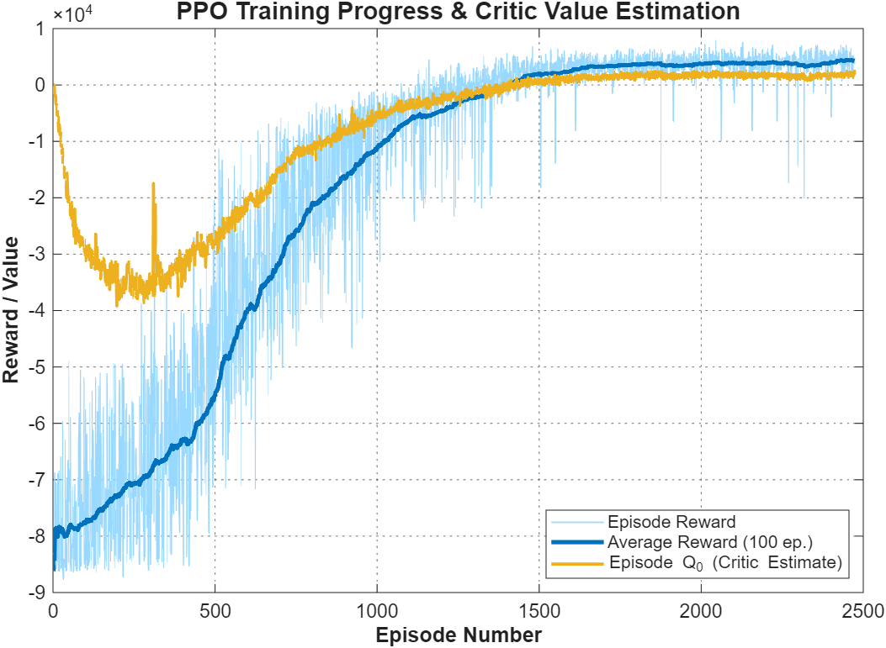
</p>

Training ran for **2500 episodes** and converged steadily, without major setbacks:

- **Episodes 0–500, exploration:** random actuation causes frequent collisions; the overlap penalties dominate, giving episode rewards around $-8 \times 10^4$.
- **Episodes 500–1500, rapid improvement:** the agent learns coordinated speed and angle commands, collisions drop sharply and parcel pairs start to be singulated.
- **Episodes 1500+, convergence:** the 100-episode moving average settles in the positive range, around $+4 \times 10^3$, with low variance.
- **Critic quality:** the critic's initial-state value estimate $Q_0$ closely follows the actual moving-average reward, so the value function is well approximated, with no divergence or over-estimation bias.

## 5. Evaluation

The trained policy was tested in closed-loop **Monte Carlo batches**, with random parcel sizes and positions in every run. The metrics are:

- **Exit gap:** longitudinal gap between consecutive parcels, measured downstream (evaluation line 1 m after the AMS exit). A negative gap means a physical overlap.
- **Success rate:** fraction of consecutive pairs whose exit gap meets the target of **0.05 m** (tolerance ±0.02 m, as in the plot titles).
- **Gap distribution:** histogram and Kernel Density Estimate (KDE) of all exit gaps.

### 5.1 Simulation 1: 10 parcels, generation interval 0.75 s

100 independent episodes; 2 parcels are added every 0.75 s until 10 parcels have been generated (9 pairs per episode).

<p align="center">
  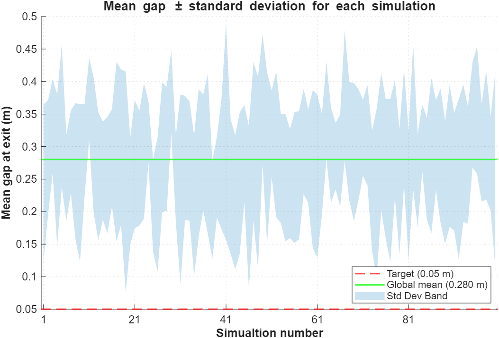
  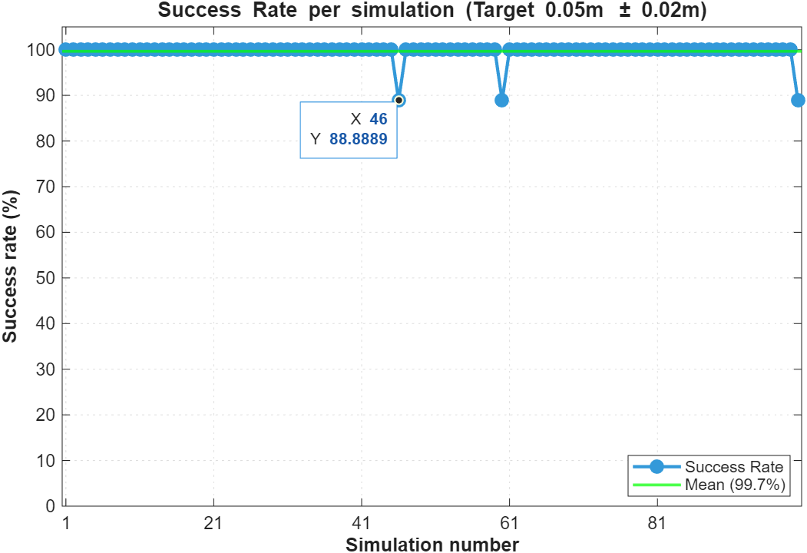
</p>

- **Global mean exit gap: 0.280 m**, more than 5× the 0.05 m target. The lower edge of the ±σ band stays above about 0.08 m in almost all runs, so the linear collision penalty teaches the agent to prefer **safe clearance over tight packing**.
- The ±σ band (about 0.12–0.45 m) shows that the agent does **not** apply a fixed speed profile: it adapts tile speeds to each parcel's size and entry position.
- **Global mean success rate: 99.7 %.** 97 out of 100 episodes reach 100 %. Only runs #46, #59 and #99 fall to 88.9 %, i.e. exactly one pair out of nine misses the target, due to unfavourable random initial conditions (maximum parcel size combined with an almost zero initial lateral offset).

<p align="center">
  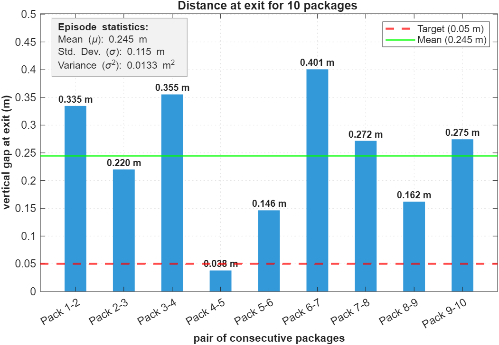
</p>

In one randomly chosen episode, the largest gap (0.401 m, pair 6–7) appears where the agent **slowed the trailing parcel** to clear upstream crowding. The smallest gap (0.038 m, pair 4–5) is slightly below the nominal target but still **positive**, so no physical contact occurred.

### 5.2 Simulation 2: 500 parcels, generation interval 0.75 s

Long-stream test of steady-state behaviour: 500 parcels generated continuously per run, 20 runs.

<p align="center">
  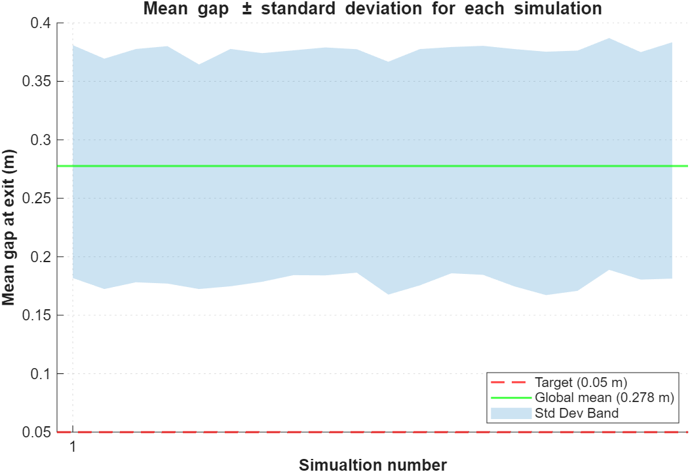
  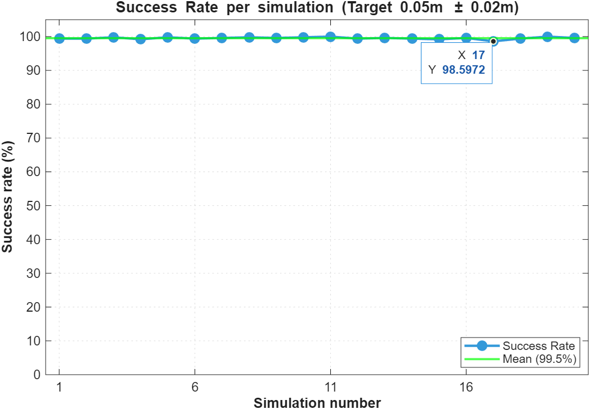
</p>

- The ±σ band becomes an **almost constant horizontal envelope**: over 500 parcels the transient noise of short episodes averages out. The policy reaches a **stationary regime with no error build-up** over long operation.
- **Global mean exit gap: 0.278 m**, practically identical to the 10-parcel batches, so performance **does not depend on stream length**.
- **Global mean success rate: 99.5 %**; the worst run (#17) still reaches **98.6 %**.

<p align="center">
  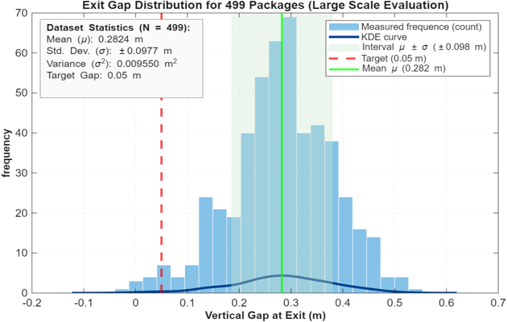
</p>

Distribution of the **N = 499** consecutive exit gaps of one 500-parcel stream: mean $\mu = 0.282$ m, standard deviation $\sigma = 0.098$ m. The distribution is **unimodal**, most exits fall within the $\mu \pm \sigma$ band, and the left tail drops off before zero. **No negative gaps** were recorded, so no overlaps or jams occurred over 499 consecutive pairs.

### 5.3 Simulation 3: 10 parcels, generation interval 0.50 s (stress test)

To find where the policy breaks down, we reduced the generation interval from 0.75 s to 0.50 s (**+50 % parcel arrival rate**) **without retraining**.

<p align="center">
  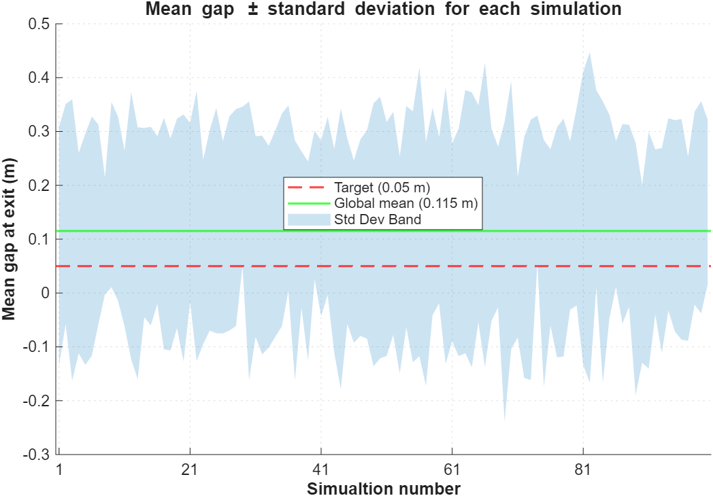
  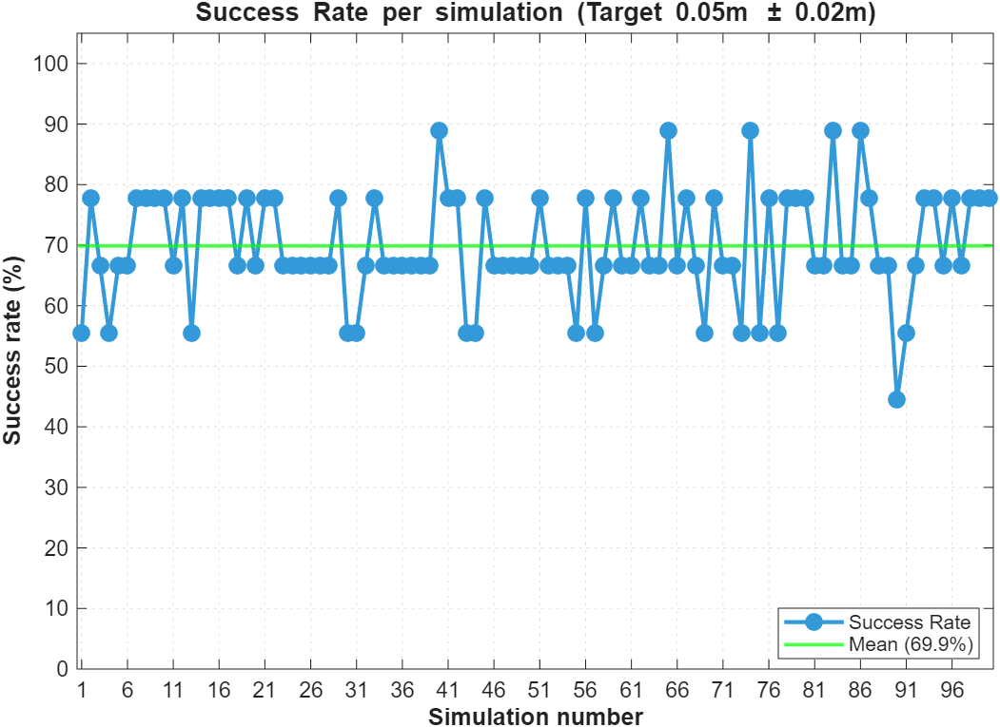
</p>

- The global mean exit gap falls to **0.115 m** (from 0.280 m), and the ±σ band reaches down to about **−0.20 m**, i.e. physical collisions.
- The global mean success rate falls to **69.9 %** (from 99.7 %), with individual runs between about 45 % and 88 %. **No run reaches 100 %.**
- Parcels arrive faster than the tiles, limited to $v_{max} = 2.2$ m/s, can clear them, so a **queue builds up upstream**.

<p align="center">
  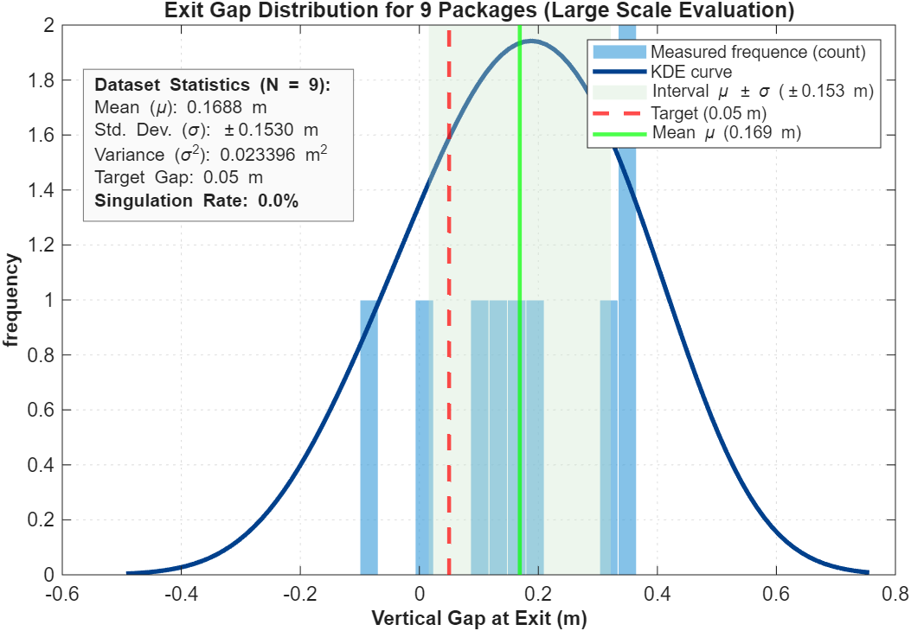
</p>

The single-episode distribution is much wider and includes a gap of about **−0.10 m**: the overcrowded grid forces erratic speed corrections and some collisions cannot be avoided.

## 6. Discussion and future work

**What worked**
- **Reward shaping was the decisive factor.** Dense progress feedback combined with a linear, all-pairs collision penalty produced a policy that keeps large safety margins and singulates almost perfectly at the nominal flow rate.
- The **cell-based observation** handled a variable number of parcels without any architectural changes, and the same policy generalizes from 10-parcel episodes to 500-parcel streams.

**Limitations**
- The policy is **conservative**: mean gaps of about 0.28 m against a 0.05 m target. This is safe, but it uses more conveyor length than necessary and could limit throughput.
- Performance **degrades outside the training distribution** (0.50 s interval), partly because of the physical speed limits of the actuators.

**Next steps**
- Retrain or **fine-tune at higher arrival rates**, or use **curriculum learning** over $t_{gen}$.
- Add a **gap-tracking term** that also penalizes gaps that are too large, to pack parcels more tightly and increase throughput.
- Extend the observation with an **upstream look-ahead window** (parcels about to enter) so the agent can anticipate crowding.
- Benchmark against a rule-based singulation controller and against the baseline reward under the same seeds.

## Authors

- **Pietro Maria Ghisi**
- **Yuxuan Lu**
- **Erwin Rafael Novicio**

Advisor: **Prof. Loris Roveda**, Politecnico di Milano. M.Sc. Mechanical Engineering, Mechatronics and Robotics.

## References

[1] L. Roveda, M. Maccarini, F. Pura, F. Reis, and B. Spahiu, "Optimizing Parcels Sorting Through Reinforcement Learning for Intralogistics," in *ECAI 2025*, I. Lynce, Ed., Frontiers in Artificial Intelligence and Applications, vol. 413. Amsterdam: IOS Press, 2025, pp. 5439–5446. doi: [10.3233/FAIA251484](https://doi.org/10.3233/FAIA251484).

[2] J. Schulman, F. Wolski, P. Dhariwal, A. Radford, and O. Klimov, "Proximal Policy Optimization Algorithms," arXiv:1707.06347, 2017.

[3] J. Schulman, P. Moritz, S. Levine, M. Jordan, and P. Abbeel, "High-Dimensional Continuous Control Using Generalized Advantage Estimation," arXiv:1506.02438, 2015.
